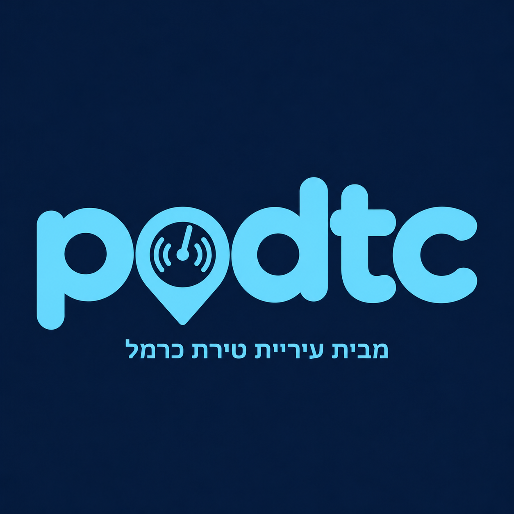

# 🎧 podtc · טירת כרמל באוזניים



**מבית עיריית טירת כרמל**

אפליקציית ווב (PWA) שהופכת את טירת כרמל לפודקאסט אחד גדול.
מפעילים שירותי מיקום ומתחילים ללכת. האפליקציה מסמנת על המפה איפה אתם נמצאים,
ובכל פעם שנכנסים לאזור של מקום עם סיפור, מתנגן **פרק של דקה או שתיים בעברית** על המקום.

## 🎨 עיצוב (גרסה 2)
- שפה חזותית בכחול כהה, תכלת ולבן, לפי הלוגו: זכוכית מטושטשת, הילות תכלת ומעברי צבע.
- מפה כהה (CARTO Dark) עם גוון כחול, וסיכות זוהרות בצבע לפי נושא.
- מסך פתיחה עם הלוגו, ונגן מלא בסגנון אפליקציות פודקאסט.

## 🆕 גרסה 6: עמוד ראשי בסגנון אתר חדשות
- 📰 **עמוד ראשי** (`js/home.js`): ברכה לפי שעה, תאריך, מזג אוויר חי בטירת כרמל (Open-Meteo), "פרק היום" כידיעה ראשית, "קרוב אליכם עכשיו", מונים מונפשים, סיורים, "הידעתם?" מתחלף, ומדורים לפי נושא בעיצוב חדשותי
- 🔴 **פס מבזקים** רץ: פרקים חדשים, מזג האוויר וכמה פרקים קרובים אליכם
- 📤 **כפתורי שיתוף**: וואטסאפ, פייסבוק, טלגרם, X, מייל, העתקת קישור ו"עוד" (שיתוף מערכת). מופיעים בפרק היום, בכל פרק בנגן ובשיתוף האפליקציה
- 📲 **הוספה למסך הבית**: כרטיס בעמוד הראשי ולשונית "התקנה". באנדרואיד ובכרום נפתחת התקנה ישירה. באייפון מוצגות הוראות צעד אחר צעד ל־Safari
- 🔗 **קישורים שימושיים**: אתר העירייה, מוקד 106, מרכזיית העירייה, המתנ"ס, אם הבנים, חי בר כרמל, רשות הטבע והגנים, עין קדם, רכבת ישראל, מנהרות הכרמל, ויקיפדיה, המועצה לשימור אתרי מורשת
- 🧭 **סרגל ניווט תחתון**: ראשי, מפה, ספרייה, התקנה

## 🆕 גרסה 5: חידון, 5 סיורים, מצב עורך ועוד
| תכונה | פירוט |
|---|---|
| 🧠 **חידון** | שאלה לכל אחד מ־24 הפרקים (`js/quiz.js`), 10 נקודות לתשובה נכונה. אחרי כל פרק מופיעה הזמנה לחידון |
| ⭐ **נקודות ותגים** | 5 נקודות לכל פרק ו־10 לכל תשובה נכונה. 7 תגים: מאזינ/ה ראשון/ה, סייר/ת, חוקר/ת העיר, ראש גדול, אלופ/ת החידון, מסיימ/ת סיור, מכיר/ה כל פינה |
| 🚶 **5 סיורים** | מהכפר אל המעיין · מורשת ובתי כנסת · טבע ומים בכרמל · סיור משפחות קצר · העיר של מחר (באופניים). לכל סיור פס התקדמות וכפתור "המשיכו". סדר התחנות מחושב אוטומטית למסלול הליכה הגיוני |
| 🛠️ **מצב עורך** | לחיצה 5 פעמים על הלוגו (או `?edit` בכתובת) פותחת אותו. אפשר לגרור סיכות, ללחוץ "קבעו כאן לפי המיקום שלי" כשעומדים במקום, ולשנות רדיוס. בסוף מייצאים JSON ושולחים אותו לעדכון לכולם |
| 🔍 **חיפוש** | חיפוש בכותרות, בנושאים ובתוך תוכן הפרקים |
| 📤 **כרטיס הישג** | תמונה ממותגת ("גיליתי X% מטירת כרמל") לשיתוף בוואטסאפ ובאינסטגרם |
| ♿ **נגישות** | מצב טקסט גדול וניגודיות גבוהה |
| 📥 **מפה בלי אינטרנט** | שמירת אריחי המפה של כל העיר לטיול בלי קליטה |
| ✉️ **משוב** | "הציעו מקום או דווחו על טעות", עם שם המקום בגוף ההודעה |

### איך מעדכנים מיקומים לכולם
1. פותחים את האפליקציה בטלפון ולוחצים 5 פעמים על הלוגו (מצב עורך).
2. בכל מקום: פותחים את הפרק, עומדים בנקודה ולוחצים "📍 קבעו כאן". אפשר גם לגרור את הסיכה במפה.
3. בספרייה לוחצים "📋 ייצוא מיקומים" ושולחים את `podtc-locations.json`.
4. מעדכנים את `lat`, `lng` ו־`radius` ב־`js/places.js`. הקובץ כבר מכיל את המזהים, אז זו החלפה פשוטה.

## 🆕 גרסה 4: 24 פרקים ו־12 נושאים
פרקים חדשים:
- 🕯️ **בית הכנסת אם הבנים** (הפלמ"ח 12): כנסייה צלבנית(?), מסגד (1579) ובית כנסת, והמבנה הראשון בעיר שהוכרז לשימור
- 🏛️ **בית המוח'תאר**: בית ראש הכפר שהפך לתחנת המשטרה
- 🏺 **מה מסתתר מתחת לרגליים**: ארכיאולוגיה מתקופת הברונזה ועד הצלבנים
- 🕊️ **קיץ 1948**: הקרבות על הכפר, בשני הנרטיבים
- 💧 **עין קדם**: מעיין בתוך נקבות חצובות, בנחל נדר
- 🥾 **מסלול נחל כלח ונחל גלים**
- 🏢 **עיריית טירת כרמל** (הרצל 6)
- 🎭 **המתנ"ס ומרכז האומנויות** (ז'בוטינסקי 43)
- ⚽ **הכדורגל** נכתב מחדש, עם היסטוריה של הפועל טירת כרמל מ־1949

נושאים חדשים: מבנים ובתי כנסת עתיקים, ספורט, עירייה, מסלולי הליכה. "זיכרון" שונה ל"אירועים חשובים".
הסיור המודרך הורחב ל־11 תחנות: "מהכפר אל המעיין" (כ־3 ק"מ).

## 🆕 גרסה 3: מפה אמיתית, סיור מודרך ונושאים חדשים
| שדרוג | פירוט |
|---|---|
| 🛰️ מפת לוויין אמיתית | צילום אוויר ברזולוציה גבוהה (Esri World Imagery) עם שמות רחובות בעברית מעליו. זו ברירת המחדל |
| 🗺️ 3 סגנונות מפה | לוויין, רחובות (CARTO Voyager, מפה מפורטת בצבע) ולילה (הסגנון הכחול של המותג). מחליפים בכפתור, והבחירה נשמרת |
| 🧭 מצפן | אלומה כחולה ליד הנקודה שלכם מראה לאן אתם מסתכלים (חיישן הטלפון, ובהליכה גם כיוון ה־GPS) |
| 🚶 סיור מודרך | "מהכפר אל ההר": 9 תחנות ממוספרות, מסלול מסומן על המפה, ובאנר "התחנה הבאה" עם חץ כיוון, מרחק וזמן הליכה. בסוף כל פרק הסיור ממשיך לתחנה הבאה |
| 👁️ מבט מהרחוב | פותח את Google Street View בנקודה, לראות את המקום לפני שמגיעים |
| 🏷️ נושאים חדשים | **זיכרון** ו**תחבורה** (סה"כ 7 נושאים) |
| 🎧 5 פרקים חדשים | שריפת הכרמל 2010 · פסיפס העליות · טירת השקדים · הכרמל של אונסק"ו · השער הצפוני (רכבת, כביש החוף ומנהרות הכרמל). סה"כ **16 פרקים** |

> שכבות המפה (Esri ו־CARTO) חינמיות לשימוש בהיקף קטן ועם ייחוס. בהשקה רשמית כדאי לעבור למפתח API
> (למשל Esri, MapTiler או Mapbox), או למפת תלת־ממד עם בניינים (MapLibre ו־OpenFreeMap).

## 🆕 שדרוגים בגרסה 2
| שדרוג | מה זה נותן |
|---|---|
| 🎙️ נגן מלא | עטיפה עם טבעת מסתובבת, דילוג בין משפטים קדימה ואחורה, מהירות הקראה, "הפרק הקרוב" |
| 📜 תמליל חי | המשפט שמוקרא מודגש, ולחיצה על משפט קופצת אליו |
| 🏷️ נושאים | היסטוריה, קהילה, תרבות, טבע, העיר של מחר. סינון במפה וברשימה |
| 🏅 התקדמות ותגים | טבעת התקדמות, אחוז מהעיר שגיליתם, ותגים: מאזין/ה ראשון/ה, סייר/ת, חוקר/ת העיר, מכיר/ה כל פינה |
| 🔔 צליל הגעה | צליל עדין ורטט כשנכנסים לאזור של מקום |
| 🧭 ניווט | "ניווט למקום" פותח מסלול הליכה ב־Google Maps |
| 🔗 שיתוף | שיתוף פרק, וקישור ישיר שפותח את הפרק (`#old-core`) |
| 🎯 מעקב | המפה עוקבת אחרי ההליכה, וכפתור המיקום מחזיר את המעקב |
| ⏱️ משך | הערכת משך לכל פרק |
| 📲 התקנה | כפתור "התקנה למסך הבית" ואייקונים מהלוגו |
| 🎧 מסך נעילה | Media Session: כותרת ולוגו במסך הנעילה, עם כפתורי עצירה והפרק הבא |

## ✨ מה יש בגרסה הראשונה (MVP)

| תכונה | איך זה עובד |
|---|---|
| 🗺️ מפה | Leaflet ומפת CARTO Dark (נתוני OpenStreetMap), עם סיכה לכל מקום ועיגול שמסמן את אזור ההפעלה (geofence) |
| 📍 מיקום חי | `navigator.geolocation.watchPosition`, עם דיוק גבוה. המיקום **לא נשלח לשום שרת** |
| 🔔 הפעלה אוטומטית | כשנכנסים לרדיוס של מקום: רטט, והפרק מתחיל לבד (אפשר לכבות בהגדרות) |
| 🗣️ קריינות בעברית | Web Speech API עם קול `he-IL`. הטקסט מחולק למשפטים כדי שזה יעבוד גם בנייד. יש תמיכה בקובצי mp3 מוקלטים, שגוברים על ההקראה |
| 📚 24 פרקים | נכתבו ממקורות ברשת: ויקיפדיה, זוכרות, המכלול, מעריב, נדל"ן סנטר ועוד. לכל פרק יש קישורי מקור |
| 🌐 תוכן חי | במקום שאין בו פרק מוכן, האפליקציה מושכת ערכים קרובים מ**ויקיפדיה העברית** (geosearch) ומקריאה אותם |
| 📝 תמליל | אפשר לקרוא כל פרק כטקסט |
| ✅ התקדמות | סימון אילו פרקים כבר נשמעו, נשמר ב־localStorage |
| 🧪 מצב הדגמה | לא בטירת כרמל? לוחצים על המפה ו"הולכים" לשם |
| 📲 התקנה ואופליין | manifest ו־service worker. אפשר להוסיף למסך הבית, ומפות שכבר נצפו נשמרות |

### הפרקים
שריפת הכרמל · פסיפס העליות · טירת השקדים · הכרמל של אונסק"ו · השער הצפוני ·
לב העיר הוותיקה · שיכוני העולים הראשונים · בית הספר של הכפר · בית הכנסת בית תנחום ·
אזור התעשייה הצפוני · מתחם תע"ש · בין העיר לים · מורדות הכרמל · שכונת נוף ים ·
הכדורגל של טירת כרמל · שנות ה־80

> ⚠️ **הקואורדינטות משוערות.** אין לי גישה למדידה בשטח, ולכן כל נקודה מסומנת `approx: true`.
> הצעד הראשון לפני השקה הוא סיבוב רגלי בעיר ותיקון ה־`lat/lng` ב־`js/places.js`.

## ▶️ הרצה

```bash
python3 -m http.server 8000   # מתוך שורש הריפו
# http://localhost:8000/podtc/
```
מיקום ב־GPS עובד רק ב־HTTPS או ב־localhost. ב־GitHub Pages זה עובד מיד.

## 🧱 מבנה

```
podtc/
  index.html            מסך פתיחה, מפה, מיני־נגן, נגן מלא וספרייה
  assets/               לוגו ואייקונים
  js/places.js          ← כאן התוכן: מקומות, רדיוסים, תסריטים, נושאים וסיורים
  js/quiz.js            שאלות החידון (התשובה הראשונה היא הנכונה)
  js/app.js             מפה, מעקב מיקום, geofencing ו־UI
  js/narrator.js        נגן: mp3 או TTS בעברית
  js/wiki.js            תוכן חי מוויקיפדיה העברית
  js/geo.js             חישובי מרחק
  sw.js, manifest       PWA ואופליין
  vendor/leaflet        ספריית המפה (מקומית, בלי CDN)
  audio/                הקלטות אמיתיות (אופציונלי)
```

**הוספת מקום** = הוספת אובייקט ל־`js/places.js`. אין צורך לגעת בקוד.

---

## 🧭 איך ממשיכים לפתח: מפת דרכים

### שלב 1: אימות בשטח (שבוע)
- סיבוב רגלי וכיול קואורדינטות ורדיוסים: 150–250 מ' באזור צפוף, 400+ מ' באזורים פתוחים.
- בדיקה על אנדרואיד (Chrome ו־Google TTS עברית) ועל אייפון (Safari, קול "Carmit").
- ראיון 2–3 תושבים ותיקים, עיריית טירת כרמל וארכיון מקומי, כדי לאמת עובדות ולהוסיף סיפורים אישיים.

### שלב 2: איכות שמע (הקפיצה הכי גדולה בחוויה)
- להחליף את ה־TTS של הדפדפן ב**הקלטות אמיתיות**: קריין מקומי, או TTS עברי איכותי
  (Google Cloud TTS `he-IL-Wavenet` / Azure `he-IL-HilaNeural`), עם מוזיקת פתיחה קצרה.
- לשמור כ־`audio/<id>.mp3` ולהוסיף `audio:` במקום המתאים. הקוד כבר תומך בזה.

### שלב 3: תוכן בהיקף גדול
- סקריפט "צינור תוכן" בצד השרת (Node/Python), שמריץ לכל נקודה את השלבים האלה:
  1. איסוף מקורות (ויקיפדיה, אתר העירייה, כתבות, OSM, ארכיונים).
  2. **ניסוח תסריט פודקאסט בעברית עם מודל שפה** (Claude API), עם הנחיה לציין מקורות ולא להמציא.
  3. ייצור שמע ב־TTS ושמירה כ־mp3.
  4. **בדיקה אנושית** לפני פרסום. זה חשוב במיוחד בנושאים רגישים כמו 1948.
- לייבא נקודות עניין מ־OpenStreetMap (בתי כנסת, בתי ספר, פארקים ואנדרטאות), כדי להגיע ל־50–100 פרקים.

### שלב 4: מוצר
- מסלולים: "סיור היסטורי, 45 דק'", "טבע בכרמל", "סיור משפחות לילדים" (אפשר לשלב את ניקי!).
- התראות ברקע כשהמסך כבוי: דורש עטיפה כאפליקציה (Capacitor) עם background geolocation,
  כי PWA לא יכולה לעקוב אחרי מיקום כשהיא סגורה.
- שפות נוספות: ערבית, רוסית ואנגלית, בהתאם לאוכלוסיית העיר.
- תוכן מהקהילה: תושבים מקליטים זיכרון קצר על המקום, ואחרי מודרציה הוא נכנס לפרקים.
- סטטיסטיקה אנונימית: אילו פרקים נשמעים ואיפה אנשים עוצרים.

### רעיונות שדרוג נוספים (לא מומשו עדיין)
- **מסלולים מודרכים** עם קו על המפה, סדר פרקים וזמן הליכה ("סיור היסטורי, 45 דק'").
- **מוזיקת רקע ופתיח מותג** לכל פרק (ג'ינגל podtc של 3 שניות).
- **תמונות ארכיון** (לפני ואחרי) בתוך הנגן: מעברות, הכפר ושנות ה־80.
- **חידון קצר** בסוף כל פרק, שמעניק נקודות. מתאים לבתי ספר.
- **מצב נגישות**: טקסט גדול וניגודיות גבוהה.
- **אירועי העירייה** שקופצים לפי מיקום ("הערב בפארק: הופעה").
- **דשבורד לעירייה** לעריכת פרקים בלי קוד (CMS קטן) וצפייה בנתוני האזנה.

### שלב 5: שותפים
- עיריית טירת כרמל ומחלקת התרבות, בתי ספר (תוכנית "הכר את עירך"), החברה להגנת הטבע ורשות הטבע והגנים (הכרמל).

## 📄 מקורות עיקריים
- [טירת כרמל — ויקיפדיה](https://he.wikipedia.org/wiki/טירת_כרמל) · [Tirat Carmel](https://en.wikipedia.org/wiki/Tirat_Carmel) · [Al-Tira, Haifa](https://en.wikipedia.org/wiki/Al-Tira,_Haifa)
- [זוכרות — א־טירה](https://www.zochrot.org/villages/village_details/49200/en)
- [תוכנית המתאר — נדל"ן סנטר](https://www.nadlancenter.co.il/article/8168) · [מעריב](https://www.maariv.co.il/economy/realestate/article-1211715)
- [תחנת חוף הכרמל — המכלול](https://www.hamichlol.org.il/תחנת_הרכבת_חיפה_–_חוף_הכרמל) · [טיולי — נחל כלח וגלים](https://www.tiuli.com/articles/356)
- [מכבי עירוני טירת כרמל](https://en.wikipedia.org/wiki/Maccabi_Ironi_Tirat_HaCarmel_F.C.)

ספריית המפה Leaflet משמשת לפי רישיון BSD-2 (`vendor/leaflet/LICENSE`). נתוני המפה: © תורמי OpenStreetMap.
